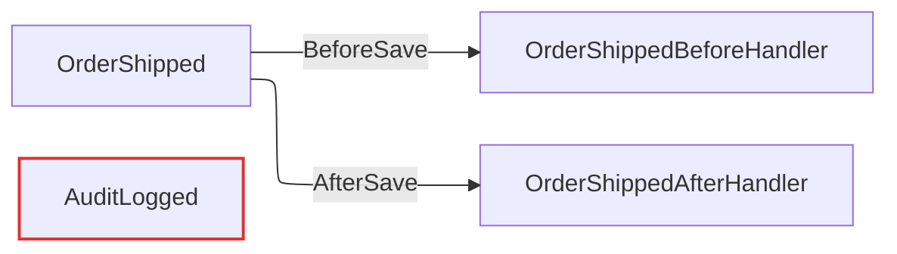

# DddTactics

面向 **.NET 10 / EF Core 10** 的 DDD 战术层基础设施。把"聚合根 → 领域事件 → 处理器（同步提交 / 异步通知）"这一最常见的 DDD 落地链路，做成一个**零魔法、可组合、可观测**的小型类库集合。

配套设计文档见仓库根目录 [`DddTactics 方案.md`](./DddTactics%20方案.md)。

---

## 1. 设计目标与核心取舍

| 目标 | 做法 |
|------|------|
| 强类型、可演进 | 强类型 ID（`IStrongId<TSelf,TValue>` + `GuidId`）、`Entity`/`AggregateRoot`/`ValueObject` 基类 |
| 运行时策略不写死 | 领域事件分发时机**必须在编译期显式标注** `[DispatchMode]`，无默认值，未标注即不被分发（并有告警） |
| 聚合-事件-处理器关系自动可见 | 源生成器扫描 `IDomainEventHandler<T>`，零结构标注产出**拓扑** |
| 框架无关 | 核心包零依赖；EF Core 仅作为可选集成；应用层验证管道可替换为原生 / MediatR / Wolverine |
| 退出机制 | 可手动实现 `IHasDomainEvents` 而不继承 `AggregateRoot`；可手动维护拓扑（关闭源生成器） |

**关键约束（务必遵守）**（详见第 8 节）：

1. 处理器必须显式标注 `[DispatchMode(BeforeSave|AfterSave)]`，否则不会被分发。
2. **BeforeSave 处理器禁止调用 `SaveChanges`**：拦截器在 `IsDispatchingBeforeSave` 期间检测到重入会抛 `InvalidOperationException`；其对主聚合的修改随主事务一并提交。
3. **AfterSave 处理器失败不回滚主事务**（至少一次语义，非 Exactly-Once）。
4. **源生成器不沿 ProjectReference 传递**：消费方（含示例）必须直接引用 `DddTactics.Topology.Generator` 项目（作为 Analyzer）。

---

## 2. 包结构

| 包 | 目标框架 | 职责 | 关键公共类型 |
|----|----------|------|--------------|
| `DddTactics.Core` | `net10.0` | 零依赖核心：强类型 ID、实体/聚合根/值对象、事件契约 | `IStrongId`, `GuidId`, `Entity<TId>`, `AggregateRoot<TId>`, `ValueObject`, `IDomainEvent`, `IHasDomainEvents`, `DomainEventDispatchMode`, `[DispatchMode]` |
| `DddTactics.EFCore` | `net10.0` | `SaveChanges` 拦截器（同步+异步）、按事件类型独立配置的 BeforeSave/AfterSave 分发器、`RepositoryBase`、`ISpecification` | `DomainEventDispatchInterceptor`, `DomainEventDispatcher`/`IDomainEventDispatcher`, `IDomainEventHandler<T>`, `DispatchModeResolver`, `RepositoryBase<TAggregate,TId>`, `Specification<T>` |
| `DddTactics.Topology`(+`.Generator`) | `net10.0` / `netstandard2.0` | 源生成器（扫描 `IDomainEventHandler<T>` + 合并 `[DispatchMode]`）、运行时拓扑报告 | `TopologyReporter`, `TopologyReport`, `TopologyRegistrationAttribute`, `ITopologySink`, `HandlerTopology`, `OrphanEventWarning` |
| `DddTactics.AppServices` | `net10.0` | `AppService` 基类 + 三套可替换验证管道（原生 / MediatR / Wolverine）+ FluentValidation 适配 | `AppService`, `IAppServiceValidator<T>`, `FluentValidationAdapter<T>`, `MediatRValidationBehavior<,>`, `ValidationMiddleware` |
| `DddTactics.Analyzers` | `netstandard2.0` | TACT001 / TACT002 / TACT003 三条设计规则 | `DddTacticsAnalyzer` |
| `DddTactics.Templates` | 模板包 | `dotnet new ddd-sln` 解决方案脚手架 | — |

---

## 3. 引用与接线（重要）

### 3.1 NuGet 引用

```xml
<PackageReference Include="DddTactics.Core"   Version="1.0.0" />
<PackageReference Include="DddTactics.EFCore" Version="1.0.0" />
<PackageReference Include="DddTactics.Topology" Version="1.0.0" />
```

### 3.2 源生成器与分析器必须直接引用（分析器不沿 ProjectReference 传递）

在**消费方项目**（非库项目）中显式引用，否则处理器拓扑不会被生成、TACT 规则不会触发：

```xml
<ItemGroup>
  <!-- 拓扑源生成器 -->
  <ProjectReference Include="..\src\DddTactics.Topology.Generator\DddTactics.Topology.Generator.csproj"
                    OutputItemType="Analyzer" ReferenceOutputAssembly="false" />
  <!-- TACT 设计分析器 -->
  <ProjectReference Include="..\src\DddTactics.Analyzers\DddTactics.Analyzers.csproj"
                    OutputItemType="Analyzer" ReferenceOutputAssembly="false" />
</ItemGroup>
```

> 发布为 NuGet 包时，生成器/分析器应进入包内的 `analyzers` 目录，从而自动对下游消费者生效。

### 3.3 EF Core 接线

```csharp
services.AddDbContext<MyDbContext>((sp, o) =>
    o.UseSqlServer(conn)
     .AddInterceptors(sp.GetRequiredService<DomainEventDispatchInterceptor>()));

services.AddDddTacticsEfCore(ServiceLifetime.Scoped); // 注册 dispatcher / resolver / interceptor

// 注册事件处理器（按事件类型可多个，每个显式声明时机）
services.AddScoped<IDomainEventHandler<OrderShipped>, OrderShippedBeforeHandler>();
services.AddScoped<IDomainEventHandler<OrderShipped>, OrderShippedAfterHandler>();
```

`AddDddTacticsEfCore` 会注册：
- `IDomainEventDispatcher` → `DomainEventDispatcher`（作用域，默认 `Scoped`；可传参改为 `Singleton`）
- `IDispatchModeResolver` → `AttributeDispatchModeResolver`（`Singleton`）
- `DomainEventDispatchInterceptor`（`Singleton`）

拦截器本身为单例，分发器在 `SaveChanges` 时从 **`DbContext` 自身的作用域容器**解析，规避"单例持有作用域服务"的陷阱。

---

## 4. 核心层（DddTactics.Core）

### 4.1 强类型 ID

```csharp
public readonly record struct OrderId(Guid Value) : IStrongId<OrderId, Guid>
{
    public static OrderId New()   => new(Guid.NewGuid());
    public static OrderId From(Guid v) => new(v);
}

// 或直接使用内置范式
public sealed class Order : AggregateRoot<GuidId> { }
```

- `IStrongId<TSelf, TValue>`：`TSelf` 必须为 `struct`（推荐 `readonly record struct`），`TValue` 为 `struct`。
- `AggregateRoot<TId>` 约束 `TId : struct`——引导使用强类型 ID，但裸 `Guid`/`int` 也可编译（退出机制）。

### 4.2 实体 / 聚合根 / 值对象

```csharp
public abstract class Entity<TId> : IEquatable<Entity<TId>> where TId : struct, IEquatable<TId>
{
    public TId Id { get; protected set; }
}

public abstract class AggregateRoot<TId> : Entity<TId>, IHasDomainEvents where TId : struct, IEquatable<TId>
{
    protected void AddDomainEvent(IDomainEvent domainEvent);   // 收集待分发事件
    protected void RemoveDomainEvent(IDomainEvent domainEvent);
    public void ClearDomainEvents();                          // 由拦截器在分发后调用
}

public abstract class ValueObject : IEquatable<ValueObject>
{
    protected abstract IEnumerable<object?> GetEqualityComponents(); // 基于分量相等
}
```

退出机制：可手动实现 `IHasDomainEvents` 而不继承 `AggregateRoot`，拓扑识别只依赖该契约（见 `samples/Sample.Alternative`）。

### 4.3 领域事件

```csharp
public sealed record OrderShipped(Guid OrderId) : IDomainEvent;
```

- 推荐命名用过去式（`OrderShipped`）；由 TACT002 启发式检查。
- 聚合在业务方法内 `AddDomainEvent(new OrderShipped(Id))`，事件在 `SaveChanges` 时被拦截器提取。

### 4.4 分发时机

```csharp
public enum DomainEventDispatchMode
{
    BeforeSave = 0, // SaveChanges 落库前，与主变更同事务同步执行
    AfterSave  = 1  // 提交后执行；失败不影响主事务，不保证 Exactly-Once
}
```

`[DispatchMode]` 标注在处理器类上（详见第 5 节）。**无默认值**。

---

## 5. EF Core 集成（DddTactics.EFCore）

### 5.1 处理器

```csharp
[DispatchMode(DomainEventDispatchMode.BeforeSave)]
public sealed class OrderShippedBeforeHandler : IDomainEventHandler<OrderShipped>
{
    private readonly AppDbContext _db;
    public OrderShippedBeforeHandler(AppDbContext db) => _db = db;

    public async Task HandleAsync(OrderShipped e, CancellationToken ct = default)
    {
        // 在 SavingChanges 阶段，其它实体尚未写入存储；
        // 读写已跟踪的实体请用 ChangeTracker / Local，而非查询未提交的存储。
        var member = _db.Members.Local.First();
        member.RecordShip(e.OrderId); // 随主事务一并提交
    }
}

[DispatchMode(DomainEventDispatchMode.AfterSave)]
public sealed class OrderShippedAfterHandler : IDomainEventHandler<OrderShipped>
{
    private readonly NotificationLog _log;
    public OrderShippedAfterHandler(NotificationLog log) => _log = log;

    public Task HandleAsync(OrderShipped e, CancellationToken ct = default)
    {
        _log.Add(e.OrderId); // 提交后通知，失败不回滚主事务
        return Task.CompletedTask;
    }
}
```

- 一个事件类型**可拥有多个处理器**，每个处理器通过 `[DispatchMode]` 独立声明时机。
- **同一事件 → 双策略（场景一）**：上述 `OrderShipped` 同时挂 `BeforeSave`（更新聚合）与 `AfterSave`（发通知）两个处理器，由拦截器在生命周期的不同节点分别触发。
- 运行时分发逻辑以事件类型为键，逐个处理器按 `IDispatchModeResolver.Resolve(handlerType, eventType)` 选择归属的 Before/After 集合，对未标注时机的处理器直接跳过。

### 5.2 拦截器生命周期

```
SaveChanges
  ├─ SavingChanges*  ── 提取事件 → 分发 BeforeSave 处理器（同事务）
  │                    └─ 暂存 AfterSave 事件，清空聚合上的事件
  ├─ base.SaveChanges ── 落库/提交
  └─ SavedChanges*   ── 提交后分发 AfterSave 处理器
SaveChangesFailed* ── 丢弃暂存的 AfterSave 事件
```

`*` 均提供同步与异步重载；异步路径以 `await` 执行，`IsDispatchingBeforeSave`（`AsyncLocal`，按执行流隔离）在 Before 阶段为 `true`。

### 5.3 拒绝 BeforeSave 中的重入 SaveChanges

```csharp
// 在 BeforeSave 处理器内调用 _db.SaveChangesAsync() 会抛出：
// InvalidOperationException: "在 BeforeSave 领域事件处理器中调用 SaveChanges 是被禁止的。"
```

`IsDispatchingBeforeSave` 为 `public bool`，可供处理器/测试观察当前是否处于 Before 分发阶段。

### 5.4 仓储与规格（最小实现，非强制）

```csharp
public sealed class OrderRepository : RepositoryBase<Order, GuidId>
{
    public OrderRepository(DbContext ctx) : base(ctx) { }
}

// 规格可组合
public sealed class ActiveOrders : Specification<Order>
{
    public override Expression<Func<Order, bool>> ToExpression() => o => !o.IsCancelled;
}
var spec = new ActiveOrders().Not().And(new HighValue(1000));
await repo.ListAsync(spec);
```

> 不强制继承 `RepositoryBase`；可直接操作 `DbContext` 作为退出机制。规格仅支持 `&` / `|` / `.Not()` 组合。

---

## 6. 拓扑（DddTactics.Topology + .Generator）

### 6.1 自动产出

源生成器在编译期扫描所有 `IDomainEventHandler<TEvent>` 实现，合并其 `[DispatchMode]`，生成 `DddTactics.Topology.Generated.DddTacticsTopologyRegistration`（`[TopologyRegistration]` 标记）。**无需任何结构标注**——聚合、事件、处理器三者关系是纯派生的。

关闭生成器（手动维护拓扑时）：

```xml
<PropertyGroup>
  <EnableDddTacticsTopology>false</EnableDddTacticsTopology>
</PropertyGroup>
```

### 6.2 运行时报告

```csharp
var report = new TopologyReporter().Build();           // 默认扫描入口程序集
Console.WriteLine(report.ToMermaid(useElk: true));      // ELK 布局（默认）；false → Dagre
Console.WriteLine(report.ToTextTree());                 // 文本树
foreach (var orphan in report.Orphans)                  // 孤儿事件告警
    Console.WriteLine($"⚠ {orphan.Message}");
```

- `Build(Assembly?)` 可选指定程序集；默认 `Assembly.GetEntryAssembly()`。
- `ToMermaid` 边标注 `BeforeSave` / `AfterSave`；孤儿事件以红色 `orphan` 样式标记。
- `Orphans`：`IDomainEvent` 类型存在但无任何标注 `[DispatchMode]` 的处理器（启发式：无法在编译期静态确定"被某聚合发出"，故 `AggregateType` 常为 `null`）。

示例输出（节选）：



---

## 7. 应用层（DddTactics.AppServices）

`AppService` 仅提供**验证 + 执行**模板，不绑定任何框架，三套验证管道可替换。

### 7.1 原生用法

```csharp
public sealed class PlaceOrderAppService : AppService { }

public record PlaceOrderRequest(Guid OrderId, decimal Amount);

public sealed class PlaceOrderValidator : IAppServiceValidator<PlaceOrderRequest>
{
    public Task<ValidationResult> ValidateAsync(PlaceOrderRequest r, CancellationToken ct = default)
        => r.Amount <= 0
            ? Task.FromResult(ValidationResult.Fail(new[] { new ValidationError(nameof(r.Amount), "金额必须为正") }))
            : Task.FromResult(ValidationResult.Ok());
}

await new PlaceOrderAppService().ExecuteAsync(request, validator, async (r, ct) =>
{
    var order = new Order(OrderId.From(r.OrderId));
    await repo.AddAsync(order, ct);
    return order.Id;
});
```

验证失败抛出 `AppServiceValidationException`（携带 `IReadOnlyList<ValidationError>`）。

### 7.2 FluentValidation 适配

```csharp
public sealed class PlaceOrderFluentValidator : AbstractValidator<PlaceOrderRequest> { /* ... */ }

services.AddScoped<IAppServiceValidator<PlaceOrderRequest>>(
    sp => new FluentValidationAdapter<PlaceOrderRequest>(sp.GetRequiredService<PlaceOrderFluentValidator>()));
```

### 7.3 MediatR 管道

```csharp
services.AddMediatR(cfg => cfg.RegisterServicesFromAssembly(typeof(Program).Assembly));
services.AddTransient(typeof(IPipelineBehavior<,>), typeof(MediatRValidationBehavior<,>));
```

`MediatRValidationBehavior` 在处理器前对请求执行所有已注册的 `IValidator<TRequest>`，失败抛 `AppServiceValidationException`。

### 7.4 Wolverine 中间件

```csharp
// Wolverine 通过消息处理管线发现并应用开放泛型中间件
public static class ValidationMiddleware
{
    public static async Task Execute<T>(IMessageContext context, Func<Task> next, T command, IServiceProvider services)
        where T : class
    {
        var validator = services.GetService(typeof(IAppServiceValidator<T>)) as IAppServiceValidator<T>;
        if (validator is not null)
        {
            var result = await validator.ValidateAsync(command);
            if (!result.IsValid) throw new AppServiceValidationException(result.Errors);
        }
        await next();
    }
}
```

> 中间件延续委托采用 `Func<Task>`，`IServiceProvider` 由 Wolverine 注入为方法参数（按目标 Wolverine 版本的中间件约定核对）。

---

## 8. 设计规则（DddTactics.Analyzers）

| 规则 | 严重度 | 触发条件 | 说明 |
|------|--------|----------|------|
| **TACT001** | 警告 | 聚合根属性/字段直接引用**同程序集**的另一聚合根 | 跨聚合应通过 ID 引用 |
| **TACT002** | 信息 | 领域事件类名不以过去式结尾（启发式：ed/d/t/n） | 命名建议 `Shipped`/`Paid`/`Cancelled` |
| **TACT003** | 警告 | `ValueObject` 子类含可写 `set`（非 `init`） | 值对象应为不可变 |

TACT002 为信息级启发式检查；TACT001/003 为设计告警。示例 `samples/Sample.Realistic` 中的 `Customer.LastOrder` 会触发 TACT001。

---

## 9. 解决方案模板（DddTactics.Templates）

```powershell
dotnet new install DddTactics.Templates   # 安装模板包
dotnet new ddd-sln -n MyBoundedContext     # 生成分层解决方案（Domain 项目 + 示例聚合）
```

生成的 `Domain` 项目引用 `DddTactics.Core`，含 `Order` 聚合与 `OrderPlaced` 事件示例。替换 `DddTactics.Core` 的 `Version` 为实际发布版本即可。

---

## 10. 示例（samples/）

| 示例 | 演示要点 |
|------|----------|
| `Sample.Minimal` | 纯领域层不变量（发布后不可编辑）+ 拓扑自动产出（ELK Mermaid + 文本树） |
| `Sample.Realistic` | 同事件双策略（BeforeSave 更新聚合 / AfterSave 通知）真实分发 + 拓扑边标签 + 孤儿事件告警 + TACT001 触发 |
| `Sample.Alternative` | 退出机制：手动实现 `IHasDomainEvents`（不继承基类）+ 源生成器 MSBuild 回退 |

运行：

```powershell
dotnet run --project samples/Sample.Realistic/Sample.Realistic.csproj -c Debug
```

---

## 11. 构建与验证

```powershell
dotnet build  DddTactics.sln -c Debug
dotnet test   DddTactics.sln -c Debug
```

测试覆盖：
- `DddTactics.Core.Tests`：LoyaltyProgram 发布后不可编辑不变量、强类型 ID 相等性。
- `DddTactics.EFCore.Tests`：BeforeSave 同事务提交 / 异常回滚、AfterSave 不回滚 / 成功提交、同一事件双策略、BeforeSave 内禁止重入 `SaveChanges`、`IsDispatchingBeforeSave` 跨执行流可见（AsyncLocal）。

---

## 12. 已知限制

- **孤儿事件告警为启发式**：扫描入口程序集中 `IDomainEvent` 类型，若无标注 `[DispatchMode]` 的处理器即告警；无法编译期确定"被某聚合发出"，`AggregateType` 通常为 `null`。
- **Wolverine 中间件**为示意性实现，运行时接线需按目标 Wolverine 版本的中间件约定核对。
- **动态运行时分发（场景三：按租户选择时机）**通过自定义 `IDispatchModeResolver` 实现，未内置具体策略。
- **规格模式**仅支持 `&` / `|` / `.Not()` 组合，未包含排序/分页等查询扩展。
- 拓扑报告默认扫描**入口程序集**；处理器分散在多个程序集时需自行 `Build(assembly)` 合并。
